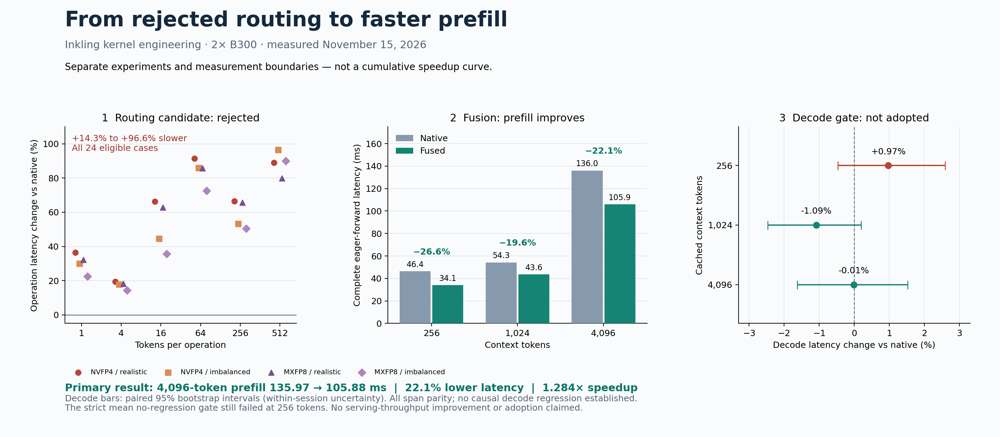
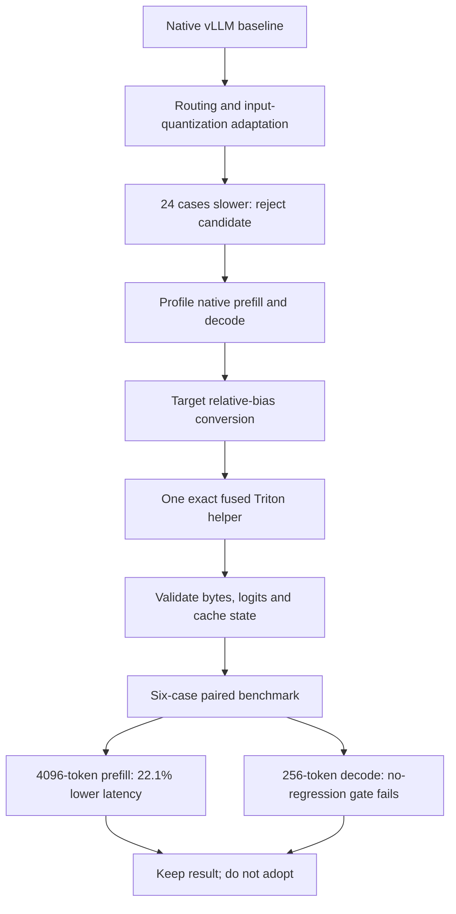

# Kernel engineering progression

The work progressed through two candidate approaches: a routing/input-quantization adaptation that was rejected, followed by a custom relative-bias fusion with a measured prefill improvement. The saved record also shows the benchmark and correctness harness becoming more rigorous.

[Download the vector chart](charts/progression-performance.svg). The figure uses all 24 eligible routing cases and all six fusion cases. Routing ratios and fusion means are checked against the committed observations. Decode error bars transform the recorded paired-bootstrap speedup intervals into latency-change intervals; these describe within-session uncertainty. Rebuild with `uv run --no-project --with matplotlib==3.10.8 python scripts/plot_progression.py`.

## Candidate 1: routing and quantization

| Run (November 15, UTC) | Engineering step | Evidence |
| --- | --- | --- |
| `tokenspeed-20261115T192820Z` | CPU dependency preflight; defer device-dependent imports | No GPU timing |
| `tokenspeed-20261115T193143Z` | Four exploratory T=1 cases | Eager checks passed, but graph-replay checks were missing; diagnostic only |
| `tokenspeed-20261115T193507Z` | Add replay correctness gates and nonuniform scale fixtures; expand to 24 cases | All eligible operation-level cases slower by 14.3–96.6%; reject |
| `tokenspeed-20261115T193905Z` | Separate Nsight capture, including additional side-stream setup before graph capture | Candidate used four launches per operation versus one native launch; attribution only |

The candidate files have identical hashes across the three saved GPU snapshots. The benchmark changed: exploratory results were replaced by a stronger validation protocol before making the performance decision. The later instrumented snapshot is not an identical-code profiler-overhead comparison.

Source: [sanitized routing results](results/tokenspeed-experiment.json). The original local experiment record supplied the run descriptions; [source-history.json](results/source-history.json) records hashes computed from the frozen snapshots during this retrospective audit.

## Change of target: native context sweep

`context-sweep-20261115T203821Z` measured full prefill and single-token decode at 256, 1,024 and 4,096 context tokens. Prefill became substantially more expensive with context, while decode changed much less. The profile identified redundant indexing, gather, masking and special-value conversion in the native relative-bias helper as a candidate for fusion.

This was bottleneck selection, not yet an optimization result. See the [native context results](results/context-sweep.json) and [prefill chart](charts/context-prefill-latency.svg).

## Candidate 2: exact relative-bias fusion

The [fused helper](experiments/relative_bias/kernel.py) combines those passes into one Triton kernel. It retains the safe attention fallback and reproduces byte-level behavior, including signed zero, NaNs, infinities, strided inputs and updated device metadata during graph replay.

| Run suffix (`relative-bias-20261115T…`, UTC) | Progress / outcome |
| --- | --- |
| `212424Z` | CPU preflight exposed validator diagnostic ordering; check input mutation before comparing output. Offline kernel compilation passed. |
| `213152Z` | Admission guard blocked an unrelated CPU-only task; resource-aware admission replaced the overly broad guard. No GPU allocation. |
| `213231Z` | CPU source/dependency preflight passed. No GPU performance result. |
| `213542Z` | Controller stalled on a reused async client; bounded subprocess admission addressed the orchestration problem before allocation. |
| `214628Z` | Platform cancellation during checkpoint loading. No candidate timing result. |
| `220452Z` | Another platform cancellation. No candidate kernel failure inferred. |
| `223321Z` | Validation failed while hashing singleton strided integer metadata; no completed timing cases. |
| `224604Z` | Fix byte fingerprinting in the validator. All six ordinary A/B cases completed with correctness checks; prefill improved, decode gate failed. Allocation cancelled during later profiling startup. |
| `231210Z` | Separate profile-only recovery completed all six instrumented cases and linked the original timing evidence by hashes. |

**The fused kernel and benchmark source hashes are unchanged across all nine snapshots.** Four distinct `correctness.py` hashes document validator revisions. These attempts are not nine progressively faster kernels, and preflight/cancellation failures do not supply missing performance points.

## What improved, and what was retained

- **Helper structure:** 37 native launches → 1 fused launch per call; 48 calls per prefill forward, yielding 1,776 → 48 helper kernels.
- **Measured primary latency:** 135.968 → 105.877 ms at 4,096-token eager prefill, a 22.13% reduction (1.284× speedup).
- **Acceptance outcome:** no adoption. At 256 tokens, mean decode latency increased by 0.97%, failing the predeclared strict gate. The helper is not called in those decode cases; this does not establish a causal regression.

See [fusion results and linked recovery](results/relative-bias.json), [prefill chart](charts/relative-bias-prefill.svg), and [decode controls](charts/relative-bias-decode.svg). The routing and fusion benchmarks have different boundaries, so their numbers must not be plotted as a single cumulative performance trajectory.

This chronology reconstructs the original run history. It does not backdate Git commits, claim an unrecorded kernel search, or add new GPU measurements.
