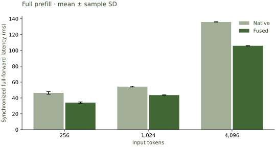
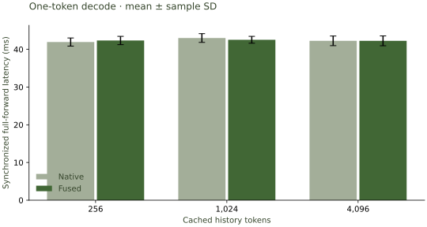
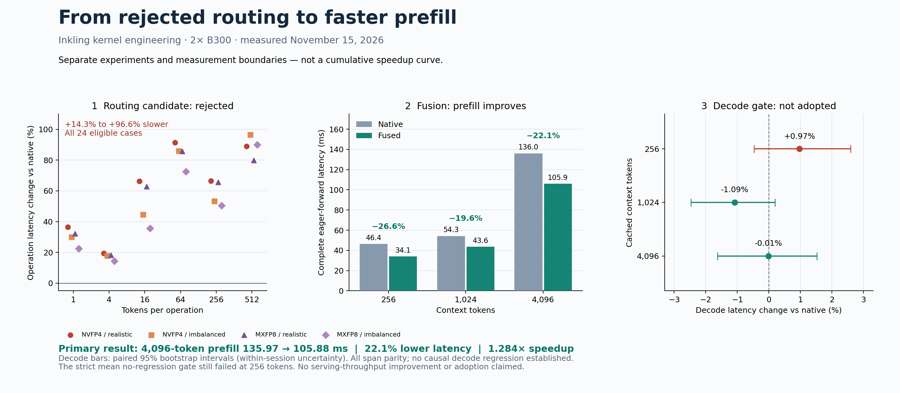

# Kernel Autoloop

An independent kernel engineering experiment by Ansh Mittal: an agent-assisted optimization loop for Inkling inference, driven by explicit benchmarks, exact correctness checks, and predeclared acceptance metrics.

**Loop:** profile → identify a bottleneck → implement a candidate → validate → benchmark → accept or reject. Benchmark execution and validation are automated; hypothesis selection and code changes were agent-assisted.

The main candidate fuses Inkling's relative-bias conversion into one Triton kernel. On **2× NVIDIA B300**, it reduced **4,096-token eager prefill latency by 22.1%** (135.97 → 105.88 ms; **1.284×**). It was **not adopted**: the strict no-decode-regression gate failed at 256 tokens. This is a measured prefill improvement, not a serving-throughput claim.



The six-case benchmark covers prefill and single-token decode at 256, 1,024, and 4,096 context tokens. Each case uses two confirmation blocks, five warmup pairs and ten measured A/B pairs per block, alternating execution order. Metrics include synchronized full-forward latency, paired 95% bootstrap intervals, memory, and separately profiled kernel counts. Byte-exact helper outputs, full-model logits, and restored cache state gate performance claims.



The repo contains the [Triton kernel](experiments/relative_bias/kernel.py), [benchmark loop](experiments/relative_bias/benchmark.py), [acceptance protocol](planning/relative-bias-protocol.json), tests, sanitized result exports, and five original charts. [Experiment notes](EXPERIMENT.md) cover the earlier rejected routing candidate, runtime requirements, and evidence limits.

```bash
uv run --no-project python -m unittest discover -s tests
uv run --no-project python -m experiments.relative_bias.benchmark
```

The second command prints the benchmark plan without launching a GPU.

## How the experiment progressed



| Stage | Change | Measured outcome / decision |
| --- | --- | --- |
| Routing candidate | Adapt TokenSpeed routing and input quantization to native vLLM | All 24 eligible cases were slower by 14.3–96.6%; rejected |
| Native profiling | Sweep three context lengths and locate redundant relative-bias conversion work | Selected a new bottleneck in the safe attention fallback |
| Relative-bias fusion | Replace multiple tensor passes with one exact Triton helper | 37 → 1 kernel launches per helper; 22.1% lower 4,096-token eager prefill latency |
| Acceptance review | Apply the original full-model correctness and decode gates | Correctness passed; decode gate failed; candidate not adopted |

The routing result measures an isolated operation; the fusion result measures a complete eager forward. They are separate experiments, not points on a shared speedup curve. The [run-by-run progression](PROGRESSION.md) also records validator fixes, failed attempts, and source hashes distinguishing actual code changes from retries.
